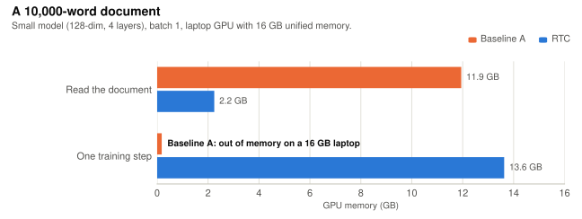
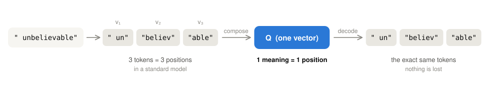
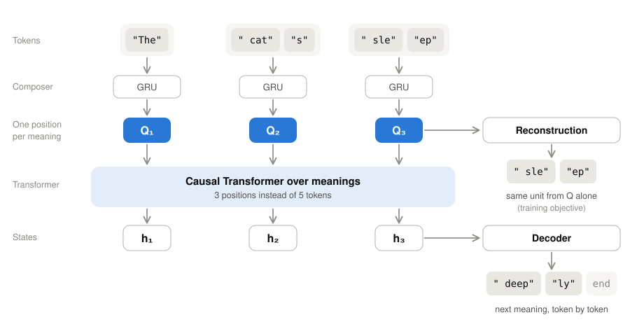

  <picture>
    <source media="(prefers-color-scheme: dark)" srcset="images/logo-dark.svg">
    
  </picture>

<b>Long contexts run out of memory. RTC puts one meaning, not one token, in each position.</b>

  
  
  
  
  

  <a href="#the-problem"><b>The problem</b></a> &middot;
  <a href="#how-it-works"><b>How it works</b></a> &middot;
  <a href="#results-at-a-glance"><b>Results</b></a> &middot;
  <a href="#benchmarks"><b>Benchmarks</b></a> &middot;
  <a href="#limitations"><b>Limitations</b></a> &middot;
  <a href="#roadmap"><b>Roadmap</b></a>

---

## The problem: long context costs memory

Every token a language model reads takes a Transformer position. Each position needs a slot in the KV cache, and attention over all positions grows with the square of their number. For long documents this, not the model weights, is what runs out first. The problem is worse for languages that tokenizers split into many pieces: there, one word costs 3–4 tokens.

**RTC composes the token vectors of one unit of meaning into a single meaning vector**, `v₁ + v₂ + … + vₙ → Q`, and runs the Transformer over meanings. The next meaning is decoded back into its exact tokens. The same text needs **far fewer positions**, and nothing is lost. In the current prototype, each unit of meaning is a single word; grouping longer phrases into one meaning is the next step.

  <picture>
    <source media="(prefers-color-scheme: dark)" srcset="images/long-document-dark.svg">
    
  </picture>

<b>Figure 1.</b> Memory needed for a 10,000-word document on a 16 GB laptop GPU. The baseline cannot even run a training step.

  <b>11.9 GB → 2.2 GB</b> to read a 10,000-word document &nbsp;·&nbsp;
  <b>~2× smaller</b> KV cache &nbsp;·&nbsp;
  <b>up to 2.5×</b> more text in the same context window

> **Note** RTC is a research prototype. Every number here was measured on small models (~1M parameters) trained on one laptop. It shows how the idea behaves at small scale; it has not yet been shown to carry over to large language models.

---

## How it works

  <picture>
    <source media="(prefers-color-scheme: dark)" srcset="images/rtc-example-dark.svg">
    
  </picture>

<b>Figure 2.</b> A standard model spends one position per token. RTC composes the token vectors v₁ … vₙ of one unit of meaning into one vector Q — one position — and decodes it back into the exact same tokens.

  <picture>
    <source media="(prefers-color-scheme: dark)" srcset="images/rtc-architecture-dark.svg">
    
  </picture>

<b>Figure 3.</b> RTC architecture. A GRU composes the tokens of each unit of meaning into one vector Q, and a causal Transformer runs over the meanings. A decoder then emits the next meaning token by token. During training, a reconstruction head also rebuilds each unit from its own Q.

Two models are compared throughout:

| | One position holds | |
|---|---|---|
| **A** | one sub-word token | Standard GPT-style baseline. |
| **B** | one unit of meaning | **RTC**: the unit's token vectors are composed, in order, into one meaning vector Q. In this prototype, a unit is one word. |

- **Training objective:** `L = L_language_model + λ · L_reconstruction`.
- **Honest reconstruction:** each unit is rebuilt from its *own* Q only, so it cannot be copied from its neighbours. Units are recovered **98% exactly** from their own Q, and only **0.8%** of the time from another unit's Q.
- **Reversible:** every Q maps back to its exact tokens and bytes. There is no unknown token and no text is lost.
- **Ordered composition:** a plain sum `v₁ + v₂ + … + vₙ` cannot tell `[a, b]` from `[b, a]`. Adding position vectors before summing does not fix this either. RTC therefore composes tokens with an order-aware GRU.

---

## Results at a glance

| | |
|---|---|
| **Long documents** | At 10,000 words, reading the document took **2.2 GB instead of 11.9 GB**. The baseline's training step did not fit in 16 GB; RTC's did. |
| **Fewer positions** | **1.2–1.3 positions per word of text.** On two morphologically rich corpora, the GPT-4o, Qwen3, Llama 3.1 and Phi-4 tokenizers need 2.75–3.9 tokens per word, so RTC uses up to **2.5× fewer positions**. On English the gain is small: 1.29 vs 1.41. |
| **Generation** | One large-model step per **meaning**, not per token: **1.6–3× faster** per generated word, and a **~2× smaller** KV cache. |
| **Quality at equal data** | Equal on English, and **5–7% better** (bits per byte) on the two other corpora. |
| **Quality at saturation** | Equal (1.754 vs 1.743 bits per byte). |
| **Training speed** | Each training step is 2–3× slower on short texts. With the same wall-clock budget there, the baseline wins. |
| **Split server/device decoding** | Plain vectors fail: they collapse into an "average meaning". The **server must choose the next unit**. |
| **Still unproven** | Quality at large scale, and exact recall of facts from long contexts. |

---

## Benchmarks

### What could fit on a 16 GB laptop (estimate)

This is a projection, not a measurement. It applies the measured positions-per-word ratio of Corpus 2 to open models' published architectures. Assumptions:
- **Model:** 4-bit weights, fp16 KV cache, about 11 GB usable by the GPU.
- **Baseline token count:** each model's own tokenizer.

| Model | A: max tokens | RTC: equivalent tokens | 16k-token document (A / RTC) | 64k (A / RTC) | 128k (A / RTC) |
|---|---:|---:|:---:|:---:|:---:|
| Llama-3.2-1B | 131k | 324k | ✅ / ✅ | ✅ / ✅ | ✅ / ✅ |
| Llama-3.2-3B | 77k | 185k | ✅ / ✅ | ✅ / ✅ | ❌ / ✅ |
| Qwen3-4B | 33k | 84k | ✅ / ✅ | ❌ / ✅ | ❌ / ❌ |
| Llama-3.1-8B | 45k | 108k | ✅ / ✅ | ❌ / ✅ | ❌ / ❌ |
| Qwen3-8B | 33k | 84k | ✅ / ✅ | ❌ / ✅ | ❌ / ❌ |
| Qwen3-14B | 11k | 25k | ❌ / ✅ | ❌ / ❌ | ❌ / ❌ |
| Phi-4 (14B) | 9k | 21k | ❌ / ✅ | ❌ / ❌ | ❌ / ❌ |

- **For a model that fits, about 2.5× more text fits in the same memory and context window.** For Qwen3 the limit is its 32k-position context window, not memory.
- **RTC does not shrink model weights.** 32B and 70B models still do not fit in 16 GB.
- **These RTC models do not exist yet.** Existing models would first have to be adapted to RTC and retrained, and long-context quality is still untested.

---

## Limitations

- **Small scale.** All quality results come from ~1M-parameter models trained on 1–2 MB corpora.
- **Single-word units so far.** Every result uses one word as the unit of meaning. Multi-word meaning units have not been tested yet.
- **Long-range context.** The small models made little use of distant context.
- **Exact recall.** The needle-in-a-haystack test, which asks the model to recover a hidden number from a long text, has not produced a conclusive result yet.
- **More parameters.** The RTC model has ~50% more parameters than the baseline because of its decoders.
- **Reconstruction is learned, not guaranteed.** About 2% of units are not rebuilt exactly. This matters most for names and numbers.

## Roadmap

1. **Multi-word meaning units:** compose several words that carry one meaning into a single Q, and measure the extra compression and its cost in quality.
2. **Needle in a haystack:** can exact facts be recovered from compressed long contexts?
3. **Retrofit a pretrained model:** add RTC to a small open model (0.6B–1.7B) and continue training it.
4. **Stronger baselines:** compare against a corpus-specific tokenizer with grouped-query attention, and against a parameter-matched baseline.

## Experimental setup

- **Hardware:** one Apple Silicon laptop with 16 GB of unified memory, PyTorch on the MPS backend.
- **Models:** 128-dim, 4-layer Transformers (~1M parameters). Speed and memory were also measured with 512-dim, 8-layer models.
- **Data:**
  - Three plain-text corpora of 1–2 MB.
  - Each is split into contiguous 80 / 10 / 10 train, validation and test parts.
- **Evaluation:**
  - Main comparisons: 3 random seeds.
  - Saturation and long-context runs: 1 seed.
  - Reconstruction: measured by free decoding, with a shuffled-vector control.

## License

Released under the [Apache License 2.0](LICENSE).
